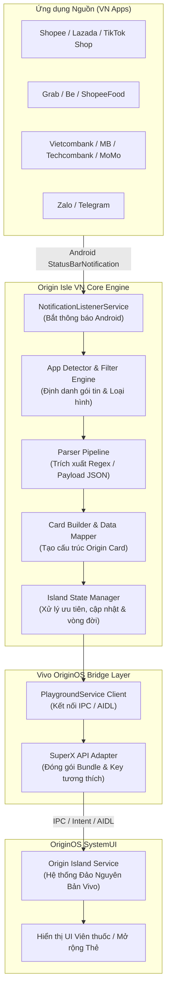
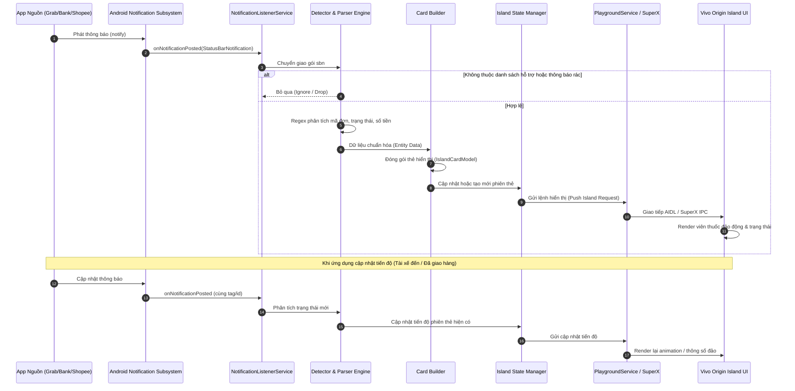

# KIẾN TRÚC HỆ THỐNG ORIGIN ISLE VIỆT NAM

Tài liệu đặc tả kiến trúc kỹ thuật và luồng dữ liệu của giải pháp Origin Isle VN, tích hợp thông báo từ các ứng dụng dịch vụ tại Việt Nam vào Origin Island (Đảo Nguyên Bản) trên giao diện Vivo OriginOS.

---

## 1. TỔNG QUAN KIẾN TRÚC (SYSTEM OVERVIEW)

Origin Isle VN hoạt động như một tầng middleware trên hệ điều hành Android, thực hiện thu nhận thông báo thời gian thực từ các ứng dụng phổ biến tại Việt Nam (giao đồ ăn, gọi xe, ngân hàng, thương mại điện tử, tin nhắn), phân tích trích xuất dữ liệu có cấu trúc, chuyển đổi thành định dạng thẻ chuẩn và kích hoạt hiển thị trực tiếp lên cụm đảo động của OriginOS thông qua giao thức SuperX API / Vivo PlaygroundService.

---

## 2. LUỒNG TUẦN TỰ XỬ LÝ THÔNG BÁO (SEQUENCE DIAGRAM)

Quy trình xử lý hoàn chỉnh từ lúc một thông báo phát sinh cho đến khi hiển thị và cập nhật trên đảo trạng thái.

---

## 3. CÁC PHÂN HỆ THÀNH PHẦN (CORE MODULES)

### 3.1. NotificationListenerService (Tầng Tiếp nhận)
* Đăng ký quyền lắng nghe thông báo cấp hệ thống `android.permission.BIND_NOTIFICATION_LISTENER_SERVICE`.
* Thu nhận các sự kiện `onNotificationPosted` và `onNotificationRemoved`.
* Bộ lọc sơ cấp: loại trừ thông báo nội bộ, thông báo đang tải tệp hoặc các thông báo không chứa thông tin biến động.

### 3.2. Detector & Parser Engine (Tầng Định danh & Phân tích)
* **App Detector**: Xác định chính xác ứng dụng nguồn thông qua `packageName` (ví dụ: `com.grabtaxi.passenger`, `com.zing.zalo`, `com.vng.zalopay`, `com.mbmobile`).
* **Category Resolver**: Phân chia thông báo vào các nhóm nghiệp vụ chính:
  * Ride-Hailing / Delivery (Chuyến đi, lộ trình tài xế, mã đơn giao nhận).
  * Banking / Fintech (Biến động số dư, mã OTP bảo mật).
  * E-Commerce (Trạng thái đơn hàng, đóng gói, giao thành công).
  * Chat / Messaging (Tin nhắn mới, người gửi).
* **Regex / Heuristic Extractors**: Tách chuỗi ký tự bằng mẫu biểu thức chính quy tối ưu, chống nghẽn CPU và bộ nhớ.

### 3.3. Card Builder & Model Mapper (Tầng Chuẩn hóa Dữ liệu)
* Chuyển đổi dữ liệu đã bóc tách sang cấu trúc mô hình `IslandCard`:
  * `title`: Tiêu đề hiển thị ngắn gọn.
  * `subtitle`: Nội dung chi tiết hoặc tiến độ.
  * `icon`: Biểu tượng ứng dụng hoặc vector biểu thị trạng thái.
  * `progress`: Chỉ số phần trăm tiến độ (0 - 100) nếu có.
  * `actions`: Các nút phản hồi hoặc chuyển hướng ứng dụng gốc qua PendingIntent.

### 3.4. Island State Manager (Tầng Quản lý Vòng đời Đảo)
* Quản lý hàng đợi hiển thị và mức độ ưu tiên giữa các ứng dụng khác nhau.
* Tự động dọn dẹp hoặc hủy thẻ khi nhận sự kiện `onNotificationRemoved` hoặc hết thời hạn hiệu lực (timeout).

### 3.5. PlaygroundService & SuperX Client (Tầng Tương thích Hệ thống Vivo)
* Đóng gói dữ liệu phù hợp với giao diện lập trình riêng của Vivo OriginOS (`SuperX API`).
* Thực hiện kết nối dịch vụ IPC thông qua `PlaygroundService` để cấp phát kênh hiển thị trên thanh trạng thái Đảo Nguyên Bản mà không cần root thiết bị.

---

## 4. NGUYÊN TẮC BẢO MẬT VÀ HIỆU NĂNG

* **Bảo mật Dữ liệu Riêng tư**: Thông báo tài chính/ngân hàng và OTP chỉ được trích xuất cục bộ trong RAM của ứng dụng, không ghi vào disk log và không truyền tải ra mạng ngoài.
* **Tối ưu Tài nguyên (Resource Efficiency)**: Tránh khởi chạy luồng thừa; sử dụng Coroutines và Dispatchers nhẹ để đảm bảo thời gian phân tích gói tin dưới 10ms, giữ mượt mà 60 FPS cho giao diện hệ thống.
